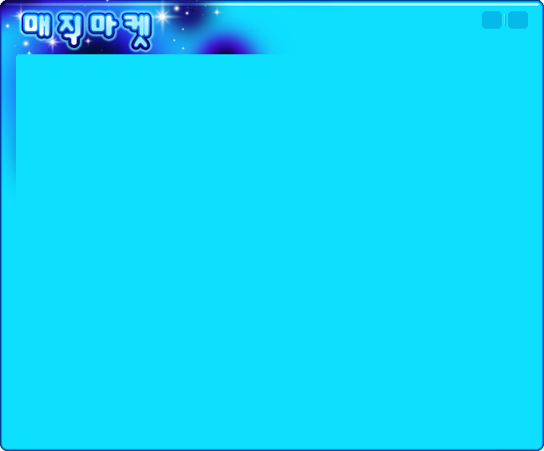
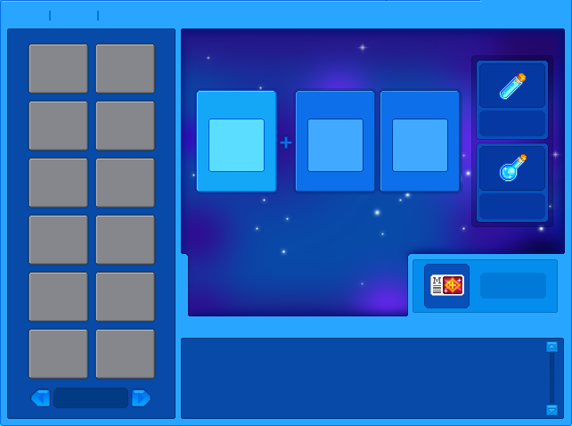
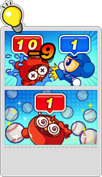
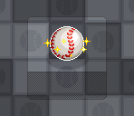

# Nội dung 13 pack KR — 2 chế độ mới Alchemist & Baseball

Đo bằng `rust/krpack` + `tools/idf.py` + `tools/i16.py`. Ảnh minh chứng ở `docs/img/kr/`.

## 1. Kiểm kê 13 pack (theo magic của entry)

| Pack | i16 (sprite) | ogg | map | json/xml | mã hoá | khác |
|---|---|---|---|---|---|---|
| CharTE | 20.743 | – | – | – | 1 | – |
| EmoTE | 9.981 | 58 | – | – | 1 | – |
| FxAsset | 10 | – | – | – | 1 | – |
| FxCharacter | 3.571 | – | – | – | – | – |
| FxContents | 845 | – | – | – | 6 | 22 |
| FxDesktop | 2.028 | – | – | – | – | 49 |
| FxHiddenCatch | 279 | – | – | – | – | 24 |
| FxMap | 301 | – | – | 7(zlib) + 4(xml) | 1.560 | 1.161 |
| FxMonster | 1.401 | – | – | – | 1 | 1 |
| FxSound | – | 797 | – | – | – | – |
| FxStage | 1.257 | – | – | – | – | 17 |
| FxTile | 3.248 | – | – | – | – | – |
| fx | 3.927 | – | – | – | 161 | 5 |

- **1.151 map** (`FxMap/Map/*`), **770 map có `<mapscript>`** (đã trích ra `out/scripts/*.xml`).
- Họ map lớn: `CAhero` 53, `Monster` 47, `MonSeal` 37, `MonPen` 34, `MonSnowBear` 30, `MonGolem` 27…
- Map mới cho chế độ: `Baseball01..10`, `MagicMarketmap01`, `Hdn_*` (HiddenCatch), `Fm_BigBattle*`.

## 2. Chế độ **Alchemist** = 마법 마켓 (Magic Market)

Không phải map đấu — đây là **hệ thống chế/tạo vật phẩm** có UI riêng, mở từ lobby.

### Asset
| Nhóm | Entry |
|---|---|
| UI chính | `FxContents/MagicMarket/*` (~90 entry): `Dlg_MagicMarketBg`, `Dlg_MMSynthesis_Bg_01`, `Dlg_MMProduction_Bg_01`, `Dlg_MMResolution_Bg_01`, `Dlg_MM*Result`, `Img_MakeEffect_01`, `Scroll_*`, `S_ToolTip` |
| Nút ngoài lobby | `FxDesktop/GlobalUI/BtMagic`, `BtMagicMarket`, `BtMixItem`, `BtMixItemAni` |
| Hộp thoại trộn | `fx/Dialog/Mix_*` (~30 entry): `Mix_Tab_Source1/2`, `Mix_Tab_Type`, `Mix_Tab_Finish`, `Mix_Tab_LuckStone`, `Mix_BtMix`, `Mix_BtMagicBox_00..06`, `Mix_BtMagicPaper` |
| Vật phẩm | `fx/Item/ItemMagicBox`, `ItemMagicPaper`, `ItemStrengthPotionRPGType1Lv1..4`, `Type2Lv1`, `ItemStrengthPotionSuperUni_{Red,Blue,Green,Black}`, `CharTE/Icon/ProbabilityPotion`, `ProtectionPotion` |
| Map riêng | `FxMap/Map/MagicMarketmap01` + `Etc/MagicMarketmap01_mm` + `Theme/Alchemist` |
| Nhân vật | `fx/MotionBlur/Blur_Witch01..03_{Up,Down,Left,Right}` (phù thuỷ mới) |
| Lobby | `FxStage/Lobby/New_BigAlchemist`, `New_SmallAlchemist` |
| Banner | `FxStage/Game/Alchemist_Start` |

### UI (ảnh)



- Tiêu đề **"마법 마켓"** vẽ sẵn trong sprite (không phải font) ⇒ decode là đọc được.
- Bố cục Synthesis: trái = lưới túi đồ 2×8; giữa = **3 ô nguyên liệu + dấu `+`**; phải = 2 ô kết quả/phụ trợ
  (icon lọ potion); dưới = ô mô tả/kết quả; có scrollbar.
- 3 chức năng suy ra từ tên file: **합성 Synthesis**, **제작 Production**, **분해 Resolution**, mỗi cái 1 dialog.

## 3. Chế độ **Baseball**

### Asset
| Nhóm | Entry |
|---|---|
| Map | `FxMap/Map/Baseball01..10` (15×13, ver 1001) + `Etc/BaseballNN_mm` (minimap i16) |
| Chọn đội | `FxMap/Prepare/PRE_SelTeamBaseball_00/01`, `PRE_NewMapTooltipBaseball` |
| Bảng điểm | `FxStage/Game/Baseball_Image` (18 frame; frame 0 = thanh **Red vs Blue** có bóng chày) |
| Hướng dẫn | `FxStage/Game/BaseballTip` (2 tranh: tỉ số 10–9, quả bóng to + bóng bay) |
| Hiệu ứng | `Game/BaseballEffect_Create`, `_Drop`, `_Eat` |
| Âm thanh | `FxSound/MP3/Baseball` (3,3 MB), `Wave/Cha_BaseballBomberDie`, `Wave/Itm_EatBaseball` |
| Vật phẩm | `fx/Item/ItemBasicbaseball` (6 frame animation), `CharTE/Icon/IconBaseballEventBox` |
| Nhiệm vụ | `fx/Dialog/DlgMissionBaseball` (khung bong bóng trắng để đặt text) |
| Theme | `FxMap/Theme/Baseball` |

### Ảnh





⇒ Chế độ **đấu đội, ghi điểm bằng bóng chày**: có bảng điểm 2 đội, bóng tạo/rơi/nhặt, item bóng,
tip hướng dẫn, map riêng 15×13.

### Script của map Baseball (trích từ `Map/Baseball01`)
```xml
<mapscript>
<time ms="20000">
  <state col="0" row="0" state="4" repeat="0"/>
  <wave name="wave/SprinklerBomb"/>
  <bomb x="20" y="20" count="1" power="5" state="3" targetcol="2" targetrow="3" extendscope="0"/>
  ...
```
- `time ms` = mốc thời gian (đợt bắn); `bomb` có `x,y,count,power,state,targetcol,targetrow`;
- `wave/SprinklerBomb` = loại hiệu ứng bắn (5.169 lần trong toàn bộ map).

## 4. Chế độ mới khác (ngoài Alchemist/Baseball)

| Chế độ | Bằng chứng asset |
|---|---|
| **AIBattle** (đấu AI) | `FxStage/Game/AIBattle_SuperStar`, `FxContents/AIBattle/Dlg_Result_*`, `Effect_Hurrah_*`, `FxDesktop/AIaider/RedZone` |
| **Airplane** (bắn máy bay) | `Game/AirplaneBigWave`, `AirplaneRetro`, `AirplaneSanta`, `AirPlaneSanta2`, `AirPlaneVampire` |
| **HiddenCatch** | pack riêng `FxHiddenCatch` (303 entry: `Bt_Close`, `Bt_Map`, `Bt_Newstart`…) |
| **BigBattle** | `Game/BigBattle_*` (Timer, Gage, Item, Arrow, Result…) |
| Khác | `Game/Alchemist_Start`, `Baseball_Image`, `GoldFlag_*`, `Bat00` |

## 5. Hệ script của map (dùng chung với VN)

Trên 770 script trích ra:

| Tag | Số lần | Ý nghĩa |
|---|---|---|
| `Action` | 86.953 | hành động (`func`, `next`, `pos`, `time`, `duration`, `speed`, `event`) |
| `ActionList` | 30.009 | danh sách hành động có `next` (state machine) |
| `Trigger` | 29.147 | điều kiện kích hoạt |
| `TriggerTable` | 6.954 | bảng trigger |
| `InitInfo` / `ScriptObject(Template)` | 6.908 / 2.108 | khởi tạo đối tượng |
| `wave` + `bomb` | 5.169 mỗi loại | đợt bomb kịch bản |
| `state`, `changetile`, `Item` | 3.588 / 827 / 1.719 | đổi trạng thái ô, đổi tile, đặt item |
| `StageClearScript` | 499 | điều kiện qua màn |

- 507/770 map có `ActionList` (chủ yếu map campaign/mission).
- **Chuỗi tiếng Hàn trong script là cp949** ⇒ khi parse phải decode cp949 (Rust: `encoding_rs` hoặc tự map).

## 6. Việc phải làm trong bản rewrite (rút ra từ trên)

1. **Script VM**: `ActionList/Action/Trigger/InitInfo` + `Time` + `wave/bomb` — đây là "ngôn ngữ nội dung".
2. **Hệ tile/map**: ver 1000/1001, lưới W×H, pre-cell 2/3 dword (đã có spec `docs/map.md`).
3. **UI theo chế độ**: mỗi chế độ có bộ asset riêng; UI = sprite ghép (không phải HTML).
4. **Magic Market**: 3 dialog (synthesis/production/resolution), công thức item — công thức nằm trong code,
   chưa thấy bảng dữ liệu ⇒ phải RE thêm nếu muốn đúng 100%.
5. **Baseball**: cần physics bóng + tính điểm + 10 map + hiệu ứng.
